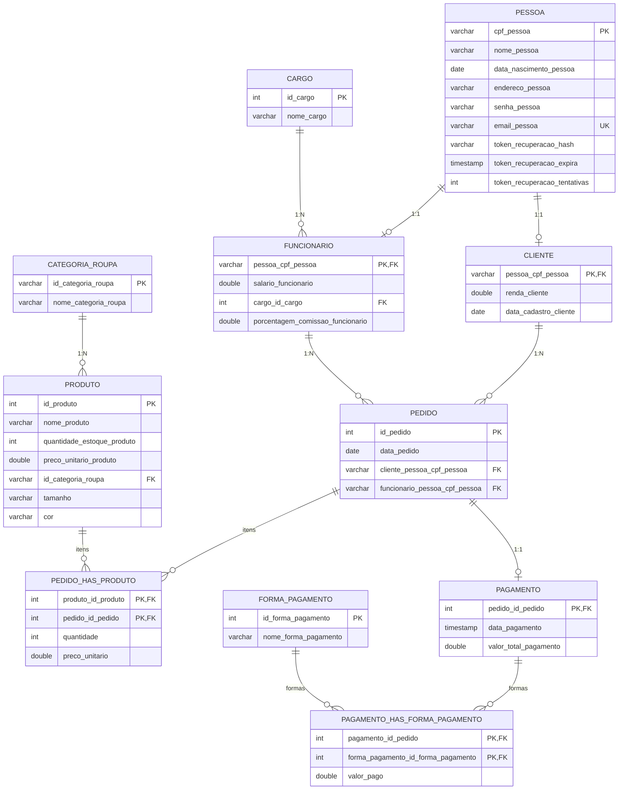

# StyleShop - Loja de Roupas

Aplicação web **Cliente/Servidor** (padrão **MVC**) com **Node.js + Express** e **PostgreSQL**, feita para a disciplina de Desenvolvimento Web 1 (DW1) - 4º bimestre 2026.

**Autor:** Gabriel de Almeida Alves | **Turma:** M32 | **Ano:** 2026

A loja funciona como um marketplace simples: qualquer pessoa navega pela vitrine e monta o carrinho; para **pagar**, é preciso fazer **login**. Funcionários/administradores, ao entrarem, ganham acesso às telas de cadastro (CRUDs).

## Funcionalidades

| Visão | O que pode fazer |
|---|---|
| **Visitante** (sem login) | Ver a vitrine, filtrar (categoria, tamanho, cor, preço, estoque), montar o carrinho, criar conta, entrar |
| **Cliente** (login) | Tudo acima + finalizar compra, pagar (simulado) e acompanhar **Meus pedidos** |
| **Administrador** (Gerente, Supervisor ou Diretor) | Tudo acima + painel administrativo e CRUDs: produtos (com imagem e reposição de estoque), categorias, pedidos e itens, pessoas, cargos e formas de pagamento |
| **Outros funcionários** (vendedor, caixa, repositor...) | Sem tela administrativa. Existem no banco para aparecer como vendedor nos pedidos presenciais. Se entrarem no site, são tratados como clientes |

- **Quem é administrador:** só os cargos listados em `backend/config/cargos.js` (`[2, 4, 10]` = Gerente, Supervisor, Diretor). O login calcula `admin` e guarda no cookie; o servidor (`middleware/auth.js`) e o menu usam esse mesmo valor.
- **Mesmo e-mail como funcionário e cliente:** em "Criar conta", se o CPF/e-mail já existe (ex.: funcionário), o sistema pede a senha atual e só acrescenta o perfil de cliente à mesma pessoa.
- **Imagens dos produtos:** clique na imagem no CRUD de produto, escolha o arquivo e salve. O servidor converte para PNG 300x300 (`sharp`) e grava em `imagens/<id>.png`.
- **Reposição de estoque:** no CRUD de produto, o painel "Repor estoque" soma unidades ao estoque (funciona com o estoque zerado).
- **Estoque no carrinho:** o carrinho e a tela de finalizar conferem o estoque atual; o servidor valida de novo no checkout e no pagamento.
- **Login/logout com cookie** (`usuarioLogado`, `httpOnly`). O perfil (cliente e/ou funcionário) vem das tabelas `cliente` e `funcionario`.
- **Autorização no servidor** (`backend/middleware/auth.js`): as rotas administrativas respondem `401` (sem login) ou `403` (cliente); as telas redirecionam. Esconder o menu não é a única proteção.
- **Pagamento simulado**: formas vindas do banco, divisão do valor entre mais de uma forma, validação básica de cartão. Dados de cartão não são enviados nem guardados.
- **Recuperação de senha por e-mail** ("Esqueci minha senha" na tela de login): o servidor envia um **código de 6 números** (vale 10 minutos, no máximo 5 tentativas erradas). O usuário digita o código e a nova senha na própria tela, então funciona em qualquer aparelho (não depende de link). No banco fica apenas o **hash SHA-256** do código (colunas `token_recuperacao_hash`, `token_recuperacao_expira` e `token_recuperacao_tentativas` em `pessoa`). A resposta do pedido é sempre a mesma, exista ou não o e-mail, e um novo pedido invalida o código anterior.
- O total é **sempre recalculado no servidor** com os preços do banco, e o CPF do comprador vem do cookie.

## Logins para teste (carga inicial)

| Perfil | E-mail | Senha |
|---|---|---|
| Administrador (Gerente) | juliana@email.com | admin123 |
| Administrador (Diretor) | maria@email.com | admin123 |
| Funcionário e cliente | fernanda@email.com | 123456 |
| Cliente | joao@email.com | 123456 |

O funcionário técnico `online` (CPF `00000000000`) apenas registra os pedidos feitos pelo site e **não consegue fazer login**.

## Como executar

1. **Pré-requisitos:** Node.js 18+ e PostgreSQL.
2. **Banco de dados** (pgAdmin/DBeaver ou `psql`):
   ```sql
   CREATE ROLE gabriel WITH LOGIN PASSWORD 'Gabriel';   -- se o usuário ainda não existir
   CREATE DATABASE styleshop OWNER gabriel;
   ```
   Conecte-se ao banco `styleshop` e execute o script `documentacao/styleshop.sql` (cria as tabelas e a carga inicial; pode ser executado de novo).
   Se você já tinha criado o banco antes da recuperação de senha, basta rodar `documentacao/alter_recuperacao_senha.sql` (só acrescenta as colunas de recuperação de senha em `pessoa`).
3. **Variáveis de ambiente:** copie `.env.example` para `.env` e ajuste se necessário:
   ```
   DB_HOST=localhost
   DB_PORT=5432
   DB_USER=gabriel
   DB_PASSWORD=Gabriel
   DB_NAME=styleshop
   PORT=3001
   ```
   Para o **e-mail de recuperação de senha** preencha também `SMTP_HOST`, `SMTP_PORT`, `SMTP_USER`, `SMTP_PASS` (no Gmail, use uma "senha de app"; a porta 465 liga o SSL sozinha). Se ficarem vazios, o link de recuperação é **impresso no terminal** do servidor, o que basta para testar. O `SMTP_FROM` é opcional: se não existir, o remetente é o próprio `SMTP_USER`.
   Ao iniciar, o servidor mostra se o SMTP está configurado. Para testar o envio isoladamente: `npm run testar-email seu@email.com`.
4. **Instalar e iniciar:**
   ```bash
   npm install
   npm start
   ```
5. Abra **http://localhost:3001** (use sempre `localhost`, o mesmo endereço do cookie).

## Estrutura do projeto

```
backend/
  server.js            # Express, rotas e arquivos estáticos
  database.js          # conexão PostgreSQL (lê o .env)
  middleware/auth.js   # cookie -> perfil (cliente / administrador)
  routes/              # mapeamento dos endpoints (Router)
  controllers/         # regras de negócio (Controller)
frontend/              # HTML5 + CSS + JS (View)
  menu.html            # vitrine
  admin.html           # painel administrativo
  login/               # entrar / criar conta
  visaoCliente/        # carrinho, finalizar, pagamento, meus pedidos
  produto/ categoria_roupa/ pedido/ pessoa/ cargo/ forma_pagamento/   # CRUDs (admin)
imagens/               # imagens dos produtos (<id>.png) e silhueta.webp (padrão)
  config/cargos.js     # cargos que acessam a administração (em backend/)
documentacao/styleshop.sql   # DDL + carga inicial
```

## Modelo de dados



- **Independentes:** `pessoa`, `cargo`, `categoria_roupa`, `forma_pagamento`.
- **1:1:** `pessoa-cliente`, `pessoa-funcionario`, `pedido-pagamento`.
- **1:N:** `cargo-funcionario`, `categoria_roupa-produto`, `cliente-pedido`, `funcionario-pedido`.
- **N:N:** `pedido-produto` e `pagamento-forma_pagamento`.

## Fluxo de compra (requisição/resposta)

1. Vitrine (`GET /produto`) -> "Adicionar" grava o carrinho no `localStorage` do navegador.
2. Carrinho -> "Finalizar compra" abre `GET /login/visaoclientefinalizar`. Sem cookie, o servidor redireciona para `/login/?voltar=...`.
3. Login (`POST /login/verificarSenha`) define o cookie e volta para a tela de finalizar.
4. Finalizar -> `POST /pedido/checkout` cria `pedido` + `pedido_has_produto` numa transação (valida estoque e usa o preço do banco).
5. Pagamento -> `POST /pagamento/:idPedido` valida a soma das formas, dá baixa no estoque e grava `pagamento` + `pagamento_has_forma_pagamento`, tudo na mesma transação.
6. "Meus pedidos" (`GET /pedido/meus`) mostra o histórico; pedidos não pagos podem ser pagos depois.

## Recuperação de senha (fluxo)

1. Em **Entrar**, o link "Esqueci minha senha" abre o campo de e-mail -> `POST /login/esqueci-senha`.
2. O servidor gera um código de 6 números (`crypto.randomInt`), grava o hash, a validade (10 min) e zera as tentativas, e envia o código por e-mail (sem SMTP, o código aparece no terminal do servidor).
3. A tela mostra os campos de código, nova senha e confirmação (mínimo 6 caracteres) -> `POST /login/redefinir-senha`.
4. Se o código estiver certo e dentro do prazo, a senha é trocada e o código é apagado (uso único). Cada código errado conta uma tentativa; ao chegar em 5, o código é invalidado e é preciso pedir outro.

## Observações

- As imagens dos produtos 2 a 10 e 50 existem (`imagens/<id>.png`); os demais usam a `silhueta.webp` até receberem upload (CRUD de produto).
- O estoque só é reduzido quando o pagamento é confirmado.
- Senhas são guardadas em texto simples, como no projeto-modelo da disciplina (uso acadêmico).
- Repositório: `NomeDoAluno_NBim_NomeProjeto` (ex.: `Gabriel_4bim_StyleShop`), com o usuário `rjhalmeman@gmail.com` como colaborador.
